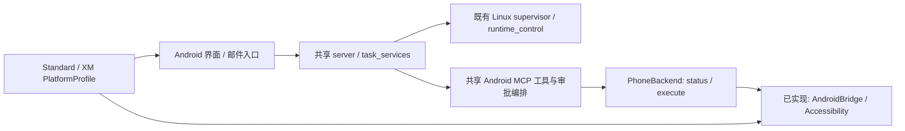

# 单仓库平台架构

> **V1.0 当前路径：** STEPX Neo 使用 ARM64 单 APK，在首次打开时从 APK 本地初始化 PRoot、Ubuntu、Python、Codex、Motor 与 Collector；不要求 Termux、厂商 Linux 或电脑。当前只完成 Neo 验收；取消回归和重启自动恢复仍待解决，详见 [V1.0 验收记录](V1.0.md)。以下 V0.x 平台说明保留为历史架构记录。

## 历史定位快照（2026-10-26）

日常维护和发布使用单一通用 Standard APK：`io.daxqo.app`，共用一套 `src/main` 与 backend，适用于 Neo、小米及其他 Android 设备。`PlatformProfile.forDevice` 保留构建身份，并按真机厂商选择设置提示；未知厂商回退构建配置。`-Xm` 仅保留为旧 `io.daxqo.xm` 安装的覆盖升级兼容入口，共用源码，不作为单独主版本维护。

手机端仍需要 Linux 用户环境。Neo 可使用 Termux + Ubuntu，不必依赖厂商 Linux；本轮便携环境验收见[记录](NEO-PORTABLE-ACCEPTANCE.md)。该验收使用隔离的 `19880` 测试服务，未迁移 Neo 现有数据，未改动正式 `18880` / `18882` 服务；也不代表所有 Neo 或小米型号均已验收。此前 V0.4 基准、双 APK 及撤下 Termux 的描述是当时的历史设计记录，不能作为当前部署定位。

## 历史设计记录：V0.4 基准与范围（2026-10-23）

Standard 以 STEPX Neo 已运行的 V0.4 源码 `8374d89` 为基准。当前采用同一仓库、同一 Android `src/main` 和同一 Python backend 维护 Standard 与 for XM；不复制 Agent 核心，不重写已有任务、对话、文件、调度、邮件、审批或运行管理。

此次调整从已有 XM 分支继续，保留此前的通用点击定位、超时及进程发现修复，将小米设置差异集中处理，并撤下 Termux/PRoot 安装脚本和 App 入口。已有手机数据及运行环境不会由本次源码调整自动迁移或卸载。

## 当时设计边界

| 层 | 实际代码 | 负责内容 |
| --- | --- | --- |
| Agent 与服务核心 | `backend/server.py`、`task_services.py`、邮件模块 | 会话、任务、运行时、文件、调度、可信邮件及审批续跑；不按手机品牌复制实现。 |
| 手机工具协议 | `backend/android_mcp_server.py` | 保留现有三个工具和原生控制策略；通过 `PhoneBackend` 调用状态与动作。 |
| 能力接口 | `backend/phone_backends.py` | 小型 Protocol 与显式工厂；默认仍为 Accessibility。 |
| Android 控制与安全 | `DeviceAccessibilityService`、`DeviceHttpBridge`、`ApprovalLedger`、`WakeActivity` | 现有无障碍、原生审批、锁屏和请求幂等检查；本轮不搬迁这些安全逻辑。 |
| 平台配置 | `android/.../platform/PlatformProfile.java`、Gradle 生成资源 | 应用标识、平台设置提示、已知商店候选顺序；实际安装情况仍由 Android 查询。 |
| Linux 生命周期 | `scripts/install_linux.py`、`backend/supervisor.py`、`runtime_control.py` | 复用 STEPX Neo 已有安装与生命周期协议。 |

这是逐步拆分：现有 Android 审批编排仍在 server，实际 HTTP 传输仍在 Android MCP 模块中；本轮只建立可替换的能力接口，避免大范围搬迁。后续可分别提取传输和审批编排，并复用现有测试。

## 当时的两个构建配置

| 项目 | Standard（默认） | for XM |
| --- | --- | --- |
| Android applicationId | `io.daxqo.app` | `io.daxqo.xm` |
| 平台资源 `platform_id` | `standard` | `xm` |
| 配对 scheme | `daxqo` | `daxqo-xm` |
| 版本 | `0.4.0` | `0.4.0-xm` |
| 手机能力默认实现 | Accessibility | Accessibility |
| Linux 安装器与协议 | 共享 | 共享；XM 设备端到端尚未验证 |

默认 `android/build.ps1` 保持 Standard；`-Xm` 与 `-Platform xm` 构建 XM。Gradle 兼容 `-Pxm=true`，也接受 `-Pplatform=standard|xm`。矛盾或未知配置会失败。构建仍使用 `assembleDebug`，输出路径保持 `android/app/build/outputs/apk/debug/app-debug.apk`；连续构建两个配置时应先保存前一个 APK。

平台 ID 独立于配对 scheme；配对协议不能用来改变控制权限。两个 APK 的 Android 私有数据独立，但 Linux 默认目录和本机端口仍共用：不要同时启动两套 Linux backend，也不把两个 APK 的配对视为 Linux 账户隔离。

## 当时记录的 Linux 契约

1. 用户先让已有 Linux 环境运行；DAXQO 不创建、移植或唤醒厂商容器。
2. 同一 `install_linux.py` 安装到默认 `~/.local/share/daxqo`，保留已有私有 capability、state 和 workspace；默认启动 supervisor 并检查本机健康接口。
3. Android 经 `127.0.0.1:18882` 查询运行桥，必要时请求启动 DAXQO 服务，再加载 `127.0.0.1:18880`。这不会启动已经关闭的厂商 Linux。
4. Standard 保持默认 `--print-pairing`；XM 仅增加 `--pairing-scheme daxqo-xm`。两者安装、运行与权限检查走同一实现。

当时 Termux/PRoot 脚本及 `--no-start` 实验分支已撤下，相关实验保留在 Git 和 [XM 历史记录](XM-ACCEPTANCE.md)。此撤下记录不再代表当前便携环境方案。

新模块同时进入 Linux 安装清单、更新包与运行桥白名单。旧运行桥若因旧白名单拒绝新模块，应先在空闲窗口按已有安装/维护流程升级运行桥，不放宽路径和哈希校验；维护前保留备份，不在任务运行时更新源码。Neo 本轮已按此流程更新 DAXQO 源码，保留原有 Linux 环境、模型配置、配对和历史任务，见[验收记录](NEO-V04-ACCEPTANCE.md)。

## 扩展方式与明确未实现项

`PhoneBackend` 只要求 `status()` 与 `execute(action,args)`。MCP 默认注册现有 `AndroidBridge`，仍经配对的原生桥、现有授权模式和 Android 系统限制执行。Profile 不选择更高权限的后端。

目录中的 `shizuku`、`oem` 标记为 `implemented=False`：仅占据扩展名称，没有 SDK、权限申请、系统服务绑定或动作实现。选择它们会在读取本地凭据、创建连接之前明确失败，不会静默退回其他能力。未来实现必须显式注册工厂、报告实际可用状态、遵守同样的授权和锁屏边界，并添加契约与真机测试；不能通过抽象接口绕过现有策略。

Standard 的 STEPX Neo PZ261A 真机回归已于 2026-10-23 完成，范围与限制见[验收记录](NEO-V04-ACCEPTANCE.md)。XM 上 Neo Linux 的可用性及新安装链路端到端运行仍未验证；安全密码锁屏、SIM 限制、长期息屏、电池行为、所有安装和支付流程及全部澎湃 OS 版本也未在本轮验收。

## 历史检查记录（2026-10-23）

- 共享后端 166 项测试通过，包含邮件/DKIM、调度、审批、运行桥、进程回收与新能力工厂；没有调用模型 API。
- 共用 Linux 安装/配对 5 项测试通过，覆盖默认启动及健康检查、失败不误报 ready、配对数据保留及无效参数拒绝。
- Standard 与 XM 均构建并检查 APK；已分别核对平台参数、应用标识、scheme、快捷方式目标与平台资源。
- 原有 2000 次被动回调、298 项审批/唤醒断言与 64 次并发重试保留；新增平台配置回归与 10 项点击快照回归。
- Neo 手机 Linux 同套 166 项测试通过；原生 11 项检查及息屏后模型自主计算闭环通过，见[验收记录](NEO-V04-ACCEPTANCE.md)。

## English

Current status: one general `io.daxqo.app` APK uses the shared Android and backend sources on Neo, Xiaomi, and other Android devices. `-Xm` remains only for upgrading legacy `io.daxqo.xm` installs. `PlatformProfile.forDevice` selects guidance from the device manufacturer. A Neo Termux + Ubuntu portable Linux userspace was validated separately; see [the portable-environment record](NEO-PORTABLE-ACCEPTANCE.md). That validation used an isolated test service and does not establish migration of existing data or production services, nor compatibility across every device model. The V0.4 baseline and Termux/PRoot removal statements below are historical records.
